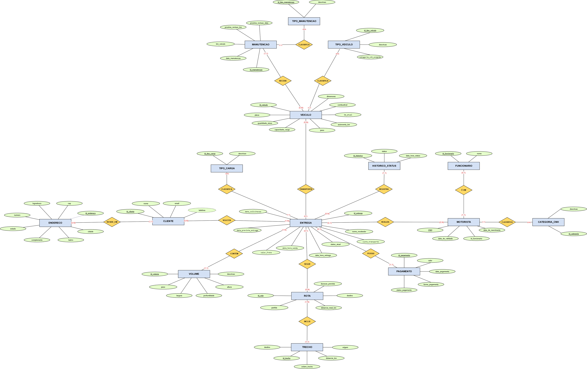

# Sistema de Gestão de Entregas e Logística (Cenário 1)

Este repositório contém a modelagem e os scripts de banco de dados para um sistema de gestão de transporte e logística. 

O objetivo do sistema é solucionar os desafios de monitoramento de entregas, permitindo o rastreamento do status das cargas, o controle da localização e habilitação dos motoristas, a gestão da frota de veículos (incluindo manutenções) e a manutenção de um histórico completo das operações.

## Diagrama de Entidade e Relacionamento (DER)

Abaixo está o modelo conceitual/lógico (DER) desenvolvido para atender às regras de negócio deste cenário:

